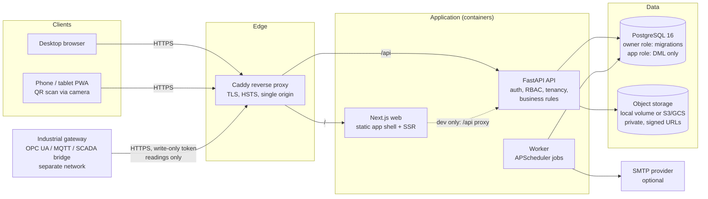

# Architecture

## 1. Environment assessment (performed before implementation)

| Capability | Finding (2026-10-25) | Consequence |
|---|---|---|
| Files, terminal, git | Available; repository `Prayer1` was empty | Project created from scratch in this repository |
| Package managers | PyPI and npm reachable through an egress proxy | Dependencies pinned; npm versions ≥ 2 weeks old except a critical Next.js security patch |
| PostgreSQL | PostgreSQL 16 installed locally | Real database used for all tests (no SQLite / mocks) |
| Docker | Docker Engine available (daemon started manually) | Images built and Compose stack run with HTTPS |
| Browser | Chromium + Playwright pre-installed | Desktop and mobile E2E tests executed |
| Cloud | `gcloud` installed but **no credentials**; no AWS/Azure CLIs | **No cloud deployment performed**; deployment template + instructions provided |

## 2. Logical architecture



### Component responsibilities

| Component | Responsibility |
|---|---|
| **Web (Next.js)** | UI only. Holds no secrets. Session is an HttpOnly cookie it cannot read; it echoes a CSRF token and the selected plant id. Service worker caches the static shell only. |
| **API (FastAPI)** | All authentication, authorization (per-endpoint permission checks + plant/department scoping), validation (Pydantic, unknown fields rejected), business rules, transactions, audit logging, file validation, reports. OpenAPI at `/api/v1/docs` (disabled in production). |
| **Worker** | PM scheduler (every 15 min), lubrication route generation and missed-task alerts (hourly), stale PdM points, email outbox with retries (every minute), monthly KPI snapshots, housekeeping. Each job is guarded by a PostgreSQL advisory lock and recorded in `job_runs`. |
| **PostgreSQL** | System of record. Foreign keys, unique and check constraints, append-only triggers on audit tables, trigram indexes for search. |
| **Object storage** | Manuals, drawings, photos, reports. Server-generated keys, private; downloads via authorized streaming (local) or short-lived signed URLs (S3/GCS). |
| **Caddy** | TLS termination with automatic certificates, HTTP→HTTPS redirect, security headers, request size limit. |
| **Industrial gateway** (external, not part of this repo) | Reads OPC UA / MQTT / PLC data on the plant network and pushes readings to `POST /api/v1/integrations/readings` using a revocable, write-only integration token. The CMMS never sends commands to control systems. |

### Why a modular monolith
One deployable API with clear module boundaries (`assets`, `workorders`, `pm`, `lubrication`, `shifts`, `inventory`,
`pdm`, `shutdowns`, `kpi`) and one worker. This keeps transactions simple (e.g. issuing stock and costing the work
order happen atomically) and operations cheap. Modules communicate through service functions, so a module can be
extracted later if load requires it.

## 3. Key design decisions

* **Multi-tenancy:** `organization → plant`; every tenant-scoped row carries `plant_id`. The API resolves the plant
  from the `X-Plant-Id` header *and* the caller's membership; every query filters by `plant_id`; object lookups
  verify ownership and return 404 across plants. Memberships may be restricted to one department. Row-level
  security is **not** used (application-level isolation, covered by tests).
* **Identity and sessions:** local accounts with Argon2id hashes; server-side sessions (SHA-256 token digests in
  the database) for revocation and idle/absolute expiry; double-submit CSRF token bound to the session.
* **Idempotent scheduling:** PM occurrences are unique per `(plan, occurrence_key)` and work orders are unique per
  occurrence; claims use `FOR UPDATE SKIP LOCKED`; runs are serialized per plant with advisory locks. Tested with
  6 concurrent scheduler runs.
* **Inventory integrity:** every balance change locks the stock row (`FOR NO KEY UPDATE`), validates availability
  and writes an append-only ledger row; moving-average valuation; stockouts recorded in an independent transaction.
* **Time:** timestamps in UTC (`timestamptz`); due dates are plant-local dates; "today" is computed in the plant's
  timezone.
* **KPIs:** computed on demand from source records with explicit availability/reason; monthly snapshots persisted
  for trends. Formulas documented in `KPI_DEFINITIONS.md`.
* **Offline:** the PWA is installable and shows an online/offline indicator; it does **not** store or queue
  maintenance records offline (deliberately, to avoid silent conflicts). See limitations.

## 4. Code map

```
backend/app/
  core/        config, db, security (Argon2, tokens), permissions matrix, KPI definitions, logging
  models/      SQLAlchemy models per domain (73 tables)
  services/    business logic: workorders, workflow, pm, inventory, lubrication, shifts, pdm, shutdowns, kpi,
               notifications, imports, reports, storage
  api/         deps (auth, CSRF, plant context), routers per module
  worker.py    background scheduler      cli.py  bootstrap / seed-demo / sync-rbac
backend/alembic/versions/   0001 schema · 0002 grants + append-only triggers · 0003 trigram indexes
frontend/src/app/           pages (App Router) · components/ · lib/ (api client, session, i18n, hooks)
deploy/                     docker-compose.yml, Caddyfile, db-init, env template
scripts/                    backup / restore / restore drill, load test, doc generator
```
