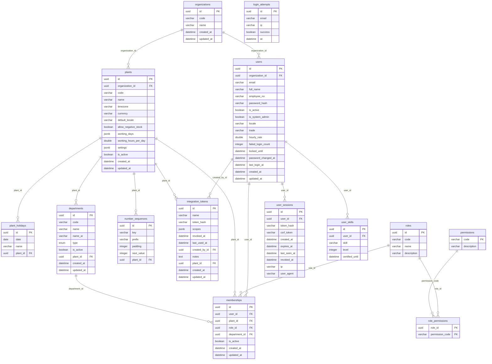
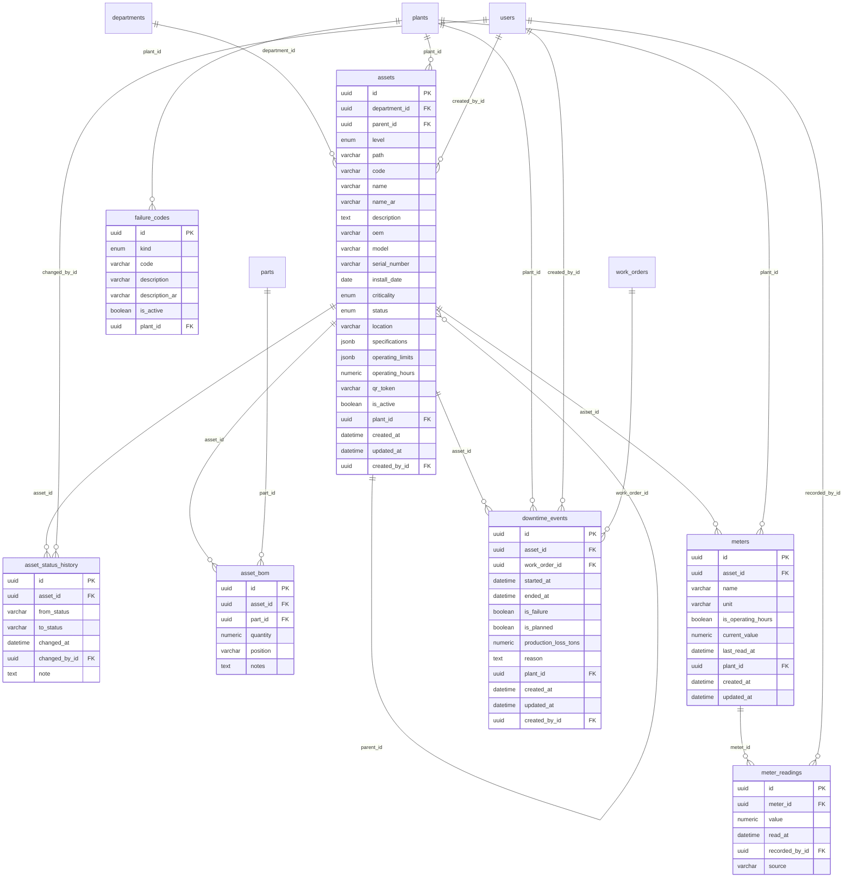
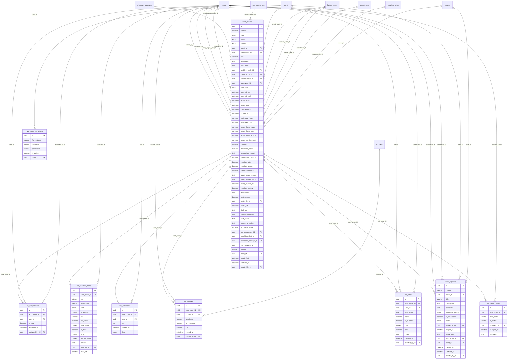
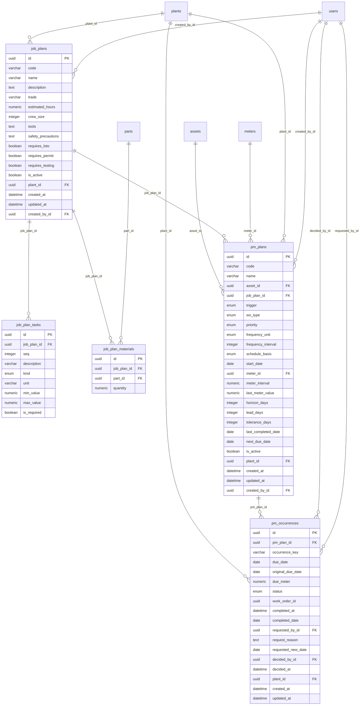
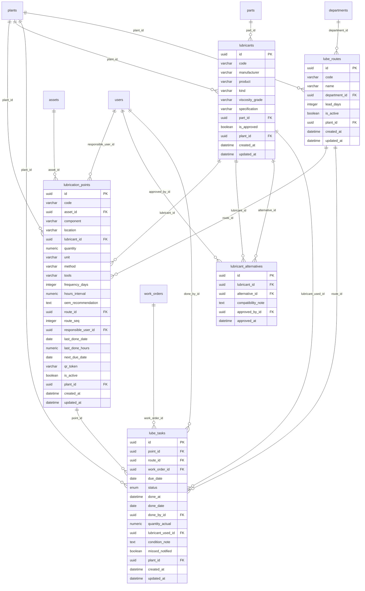
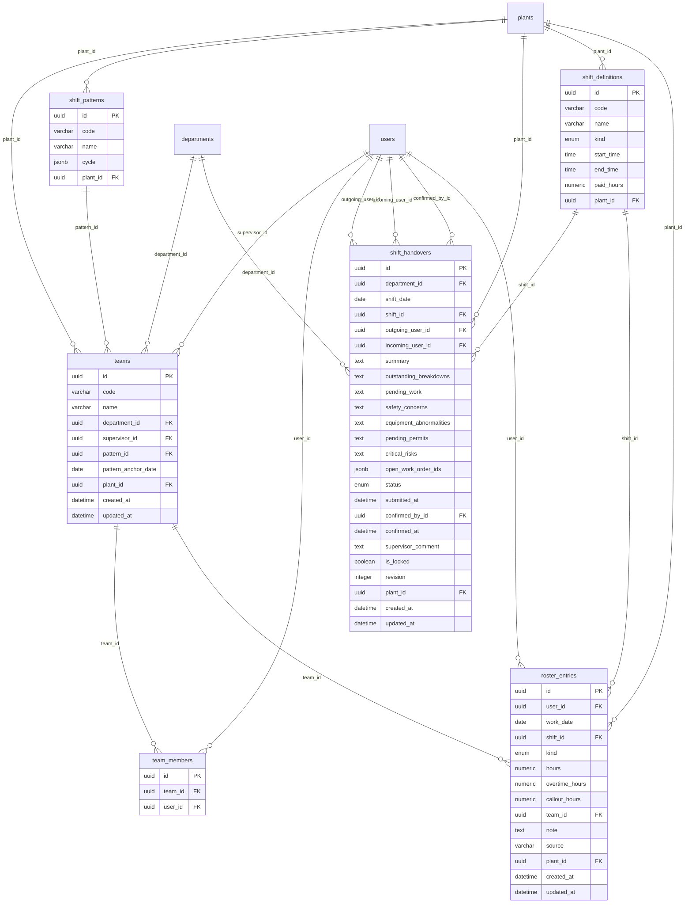
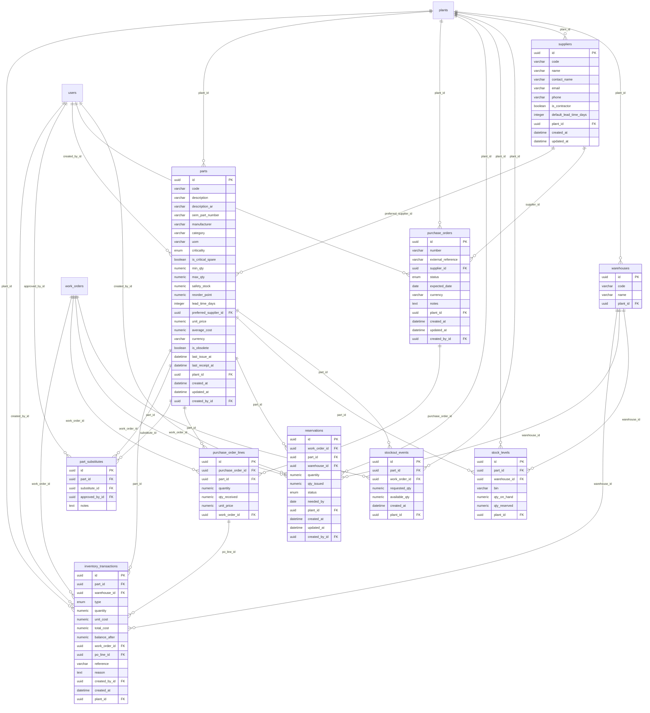
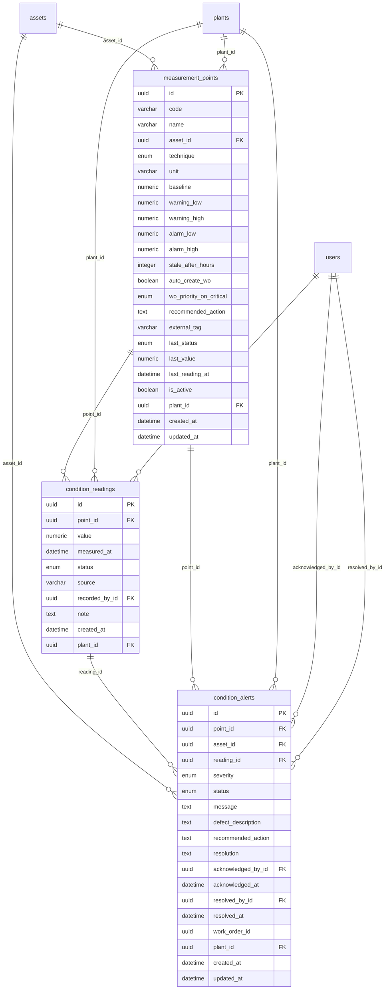
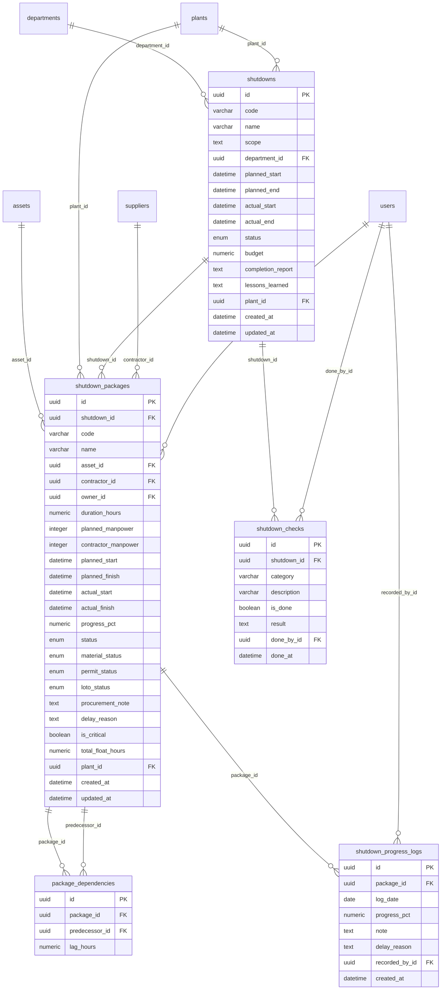
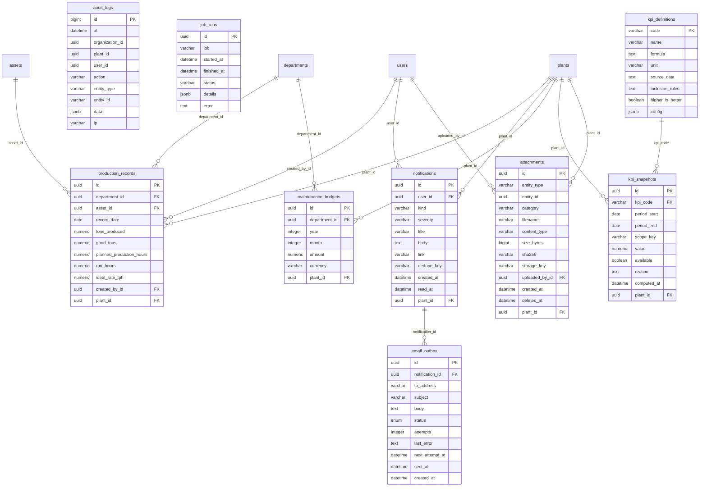

# Entity-relationship diagrams

_Generated by `scripts/gen_docs.py`. One diagram per domain (Mermaid); references to tables in other domains are shown as relationships too._

## Tenancy & identity

## Assets

## Work management

## Preventive maintenance

## Lubrication

## Shifts & manpower

## Inventory & purchasing

## Condition monitoring

## Shutdowns

## KPIs, reporting & system

